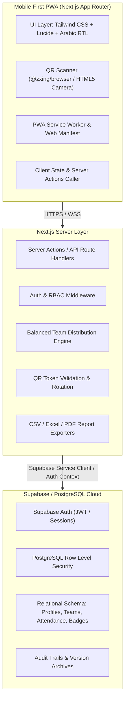

# SCOUT HUB — System Architecture & Design Specification
**نظام كشافة هب — المنصة الكشفية المتكاملة للهواتف المحمولة**

---

## 1. Executive Summary & Core Mission
**Scout Hub (كشافة هب)** is a mobile-first, production-grade Arabic Scout Management Platform designed for scout groups and leaders. It transforms weekly Friday scout gatherings, team formation, uniform compliance, and badge achievements from disorganized manual registers into an engaging, gamified, and strictly secure digital experience.

---

## 2. Architecture Principles
1. **Mobile-First Everything**:
   - Primary viewports: 360px–430px (modern smartphones) with full support for small screens down to 320px, as well as tablet and desktop viewports.
   - One-handed thumb operations: bottom action bars, large touch targets (minimum 44x44px), drawer dialogs, and clear confirmation modals.
2. **Security & Privacy for Minors**:
   - Zero exposure of personal member contact info (phone/email) to regular peers.
   - Unpredictable, rotating QR tokens. QR codes **never** contain raw personal identity info or database IDs directly.
   - Server-authoritative attendance recording; client timestamps are ignored.
   - Multi-tier Role-Based Access Control (RBAC): `super_admin`, `admin`, `attendance_leader`, and `member`.
   - Strict PostgreSQL Row Level Security (RLS) policies on all tables.
3. **RTL-Native Design System (Cairo / Tajawal)**:
   - High-contrast outdoor scout palette: Deep Forest Green (`#173C32`), Emerald (`#23836B`), Warm Sand (`#F5EBD8`), Soft Cream (`#FCF9F2`), Adventure Orange (`#E89B50`), and Charcoal (`#24342E`).
   - Natural Egyptian and Modern Standard Arabic phrasing that inspires enthusiasm and adventure.
4. **Deterministic & Balanced Team Engine**:
   - Mode A (Mixed Stages): Fair distribution of counts, stage balance, and commitment levels across all teams.
   - Mode B (Separated Stages): Independent distribution of teams within individual scout stages.
   - Seeded shuffling for reproducible previews, manual swaps/moves, atomic publish transitions, and persistent version archives.
5. **Robust Attendance System**:
   - Mobile camera QR scanner using back-facing camera with fallback manual search.
   - Live server validation, duplicate scan detection, arrival time calculation, and uniform compliance tracking.

---

## 3. High-Level Technology Stack



---

## 4. Layered Directory & Code Organization
```
src/
├── app/
│   ├── (auth)/
│   │   ├── login/
│   │   ├── register/
│   │   └── forgot-password/
│   ├── (member)/
│   │   ├── dashboard/
│   │   ├── card/           # Digital Scout ID Card & Printable view
│   │   ├── team/           # Member's assigned team view (post-publish)
│   │   └── profile/
│   ├── (admin)/
│   │   ├── admin/
│   │   │   ├── dashboard/
│   │   │   ├── members/    # Member roster & management
│   │   │   ├── teams/      # Team generator, drafts, publishing
│   │   │   ├── scanner/    # Fast mobile QR attendance scanner
│   │   │   ├── sessions/   # Friday sessions management
│   │   │   ├── reports/    # Attendance analytics & CSV/Excel export
│   │   │   └── settings/   # Scout stage & group settings
│   ├── api/
│   │   ├── attendance/verify/
│   │   └── exports/
│   ├── layout.tsx
│   ├── page.tsx            # Public Landing Page
│   └── manifest.ts         # PWA Manifest
├── components/
│   ├── ui/                 # Buttons, Dialogs, Cards, Badges, Tabs
│   ├── scout/              # Scout-specific UI components
│   │   ├── ScoutCard.tsx
│   │   ├── QRScannerView.tsx
│   │   ├── TeamRosterCard.tsx
│   │   ├── BadgeDisplay.tsx
│   │   └── FridayAttendanceWidget.tsx
│   └── navigation/         # BottomNav for mobile, TopNavbar
├── lib/
│   ├── supabase/           # Client, Server, and Admin helpers
│   ├── teams/              # Balanced distribution algorithm
│   ├── qr/                 # Secure token generation & crypto validation
│   ├── utils/              # Cairo dates, formatting, RTL helpers
│   └── auth/               # RBAC role checks & session utilities
├── types/                  # TypeScript database & domain models
└── styles/                 # Global styles, Tailwind custom colors
```

---

## 5. Security & Data Protection Architecture
- **Bearer Token Isolation**: The QR payload is a cryptographic UUID referencing a `qr_credentials` record with an active status and timestamp. Compromised or lost cards can be revoked and reissued with one click without changing the member's account.
- **Server-Side Authorization**: Every Server Action verifies `supabase.auth.getUser()` and validates the caller's role against the `user_roles` table. Client-side claims are never trusted for authorization.
- **Atomic Operations**: Team publishing updates the current distribution version, switches memberships, and marks drafts atomically within a database transaction.
- **Strict Data Minimization**: Regular member queries are constrained by RLS to never leak teammates' phone numbers, emails, or personal commitment preferences.
