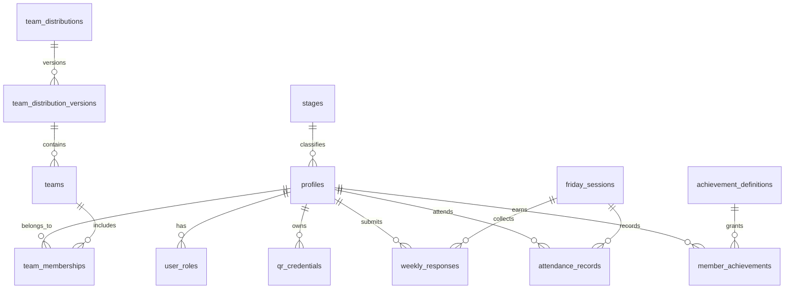

# SCOUT HUB — Database Architecture & Schema Specification
**مخطط قاعدة البيانات ونظام العلاقات**

---

## 1. Schema Diagram Overview

---

## 2. Table Specifications

### 2.1 `stages` (المراحل الكشفية)
| Column | Type | Constraints | Description |
|---|---|---|---|
| `id` | UUID / Text | PRIMARY KEY | e.g. `stage_1`, `stage_2`, `stage_3` |
| `name_ar` | Text | NOT NULL | "المرحلة الأولى", "المرحلة الثانية", "المرحلة الثالثة" |
| `code` | Text | UNIQUE NOT NULL | e.g. `cubs`, `scouts`, `advanced` |
| `min_age` | Integer | NULL | Minimum age |
| `max_age` | Integer | NULL | Maximum age |
| `created_at` | TIMESTAMPTZ | DEFAULT NOW() | Record creation |

### 2.2 `profiles` (ملفات الأعضاء والقادة)
| Column | Type | Constraints | Description |
|---|---|---|---|
| `id` | UUID | PRIMARY KEY, FK -> auth.users(id) | Supabase auth user reference |
| `member_number` | Text | UNIQUE NOT NULL | Formatted serial e.g. `SCT-2026-0042` |
| `full_name` | Text | NOT NULL | Full Arabic name |
| `phone` | Text | NULL | Private phone number |
| `stage_id` | Text | FK -> stages(id) | Assigned scout stage |
| `initial_commitment` | Text | NOT NULL | `committed`, `inactive`, `circumstances` |
| `avatar_url` | Text | NULL | Profile image storage path |
| `is_active` | Boolean | DEFAULT TRUE | Membership status |
| `created_at` | TIMESTAMPTZ | DEFAULT NOW() | Registration date |
| `updated_at` | TIMESTAMPTZ | DEFAULT NOW() | Last update timestamp |

### 2.3 `user_roles` (الأدوار والصلاحيات)
| Column | Type | Constraints | Description |
|---|---|---|---|
| `id` | UUID | PRIMARY KEY DEFAULT gen_random_uuid() | Record ID |
| `user_id` | UUID | FK -> profiles(id) ON DELETE CASCADE | Member ID |
| `role` | Text | NOT NULL | `super_admin`, `admin`, `attendance_leader`, `member` |
| `created_at` | TIMESTAMPTZ | DEFAULT NOW() | Assigned at |
| UNIQUE(`user_id`, `role`) | - | Composite uniqueness | Prevents duplicate role rows |

### 2.4 `qr_credentials` (بطاقات الهوية والرموز المشفرة)
| Column | Type | Constraints | Description |
|---|---|---|---|
| `id` | UUID | PRIMARY KEY DEFAULT gen_random_uuid() | Unique unguessable bearer token |
| `member_id` | UUID | FK -> profiles(id) ON DELETE CASCADE | Associated member |
| `is_active` | Boolean | DEFAULT TRUE | Active status flag |
| `revoked_at` | TIMESTAMPTZ | NULL | Revocation date |
| `revocation_reason` | Text | NULL | Reason for re-issuance |
| `created_at` | TIMESTAMPTZ | DEFAULT NOW() | Generation timestamp |

### 2.5 `team_distributions` & `team_distribution_versions` (محرك وإصدارات توزيع الفرق)
| Column | Type | Constraints | Description |
|---|---|---|---|
| `id` | UUID | PRIMARY KEY DEFAULT gen_random_uuid() | Unique distribution ID |
| `title` | Text | NOT NULL | e.g. "تقسيم معسكر ربيع 2026" |
| `mode` | Text | NOT NULL | `mixed_stages` OR `separate_stages` |
| `status` | Text | NOT NULL | `draft`, `published`, `archived` |
| `version_number` | Integer | NOT NULL DEFAULT 1 | Version sequence |
| `random_seed` | Text | NOT NULL | Deterministic reproducibility seed |
| `is_current_published` | Boolean | DEFAULT FALSE | Flag for the active team distribution |
| `published_at` | TIMESTAMPTZ | NULL | Publication timestamp |
| `created_by` | UUID | FK -> profiles(id) | Admin creator |
| `created_at` | TIMESTAMPTZ | DEFAULT NOW() | Creation date |

### 2.6 `teams` (الفرق والطلائع الكشفية)
| Column | Type | Constraints | Description |
|---|---|---|---|
| `id` | UUID | PRIMARY KEY DEFAULT gen_random_uuid() | Team ID |
| `distribution_id` | UUID | FK -> team_distributions(id) | Belongs to distribution |
| `name` | Text | NOT NULL | e.g. "فريق النسور", "طليعة الفهد" |
| `stage_id` | Text | NULL, FK -> stages(id) | If stage-separated mode |
| `leader_id` | UUID | NULL, FK -> profiles(id) | Assigned team patrol leader |
| `color_hex` | Text | DEFAULT '#23836B' | Accent theme color |
| `icon_name` | Text | DEFAULT 'compass' | Scout icon key |
| `total_points` | Integer | DEFAULT 0 | Accumulated gamification points |

### 2.7 `team_memberships` (عضويات الأفراد في الفرق)
| Column | Type | Constraints | Description |
|---|---|---|---|
| `id` | UUID | PRIMARY KEY DEFAULT gen_random_uuid() | Record ID |
| `team_id` | UUID | FK -> teams(id) ON DELETE CASCADE | Team assignment |
| `member_id` | UUID | FK -> profiles(id) ON DELETE CASCADE | Member reference |
| `is_leader` | Boolean | DEFAULT FALSE | Is patrol leader flag |
| `created_at` | TIMESTAMPTZ | DEFAULT NOW() | Assignment date |
| UNIQUE(`team_id`, `member_id`) | - | Uniqueness per team | Single membership per team |

### 2.8 `friday_sessions` (اجتماعات الجمعة الأسبوعية)
| Column | Type | Constraints | Description |
|---|---|---|---|
| `id` | UUID | PRIMARY KEY DEFAULT gen_random_uuid() | Session ID |
| `session_date` | DATE | NOT NULL UNIQUE | Friday date (Africa/Cairo) |
| `title` | Text | NOT NULL | e.g. "اجتماع الجمعة - تدريب العقد الكشفية" |
| `start_time` | TIME | NOT NULL DEFAULT '08:30:00' | Planned start time |
| `late_threshold_time` | TIME | NOT NULL DEFAULT '08:45:00' | Late cutoff time |
| `is_open_for_attendance` | Boolean | DEFAULT FALSE | Scanner access control |
| `response_deadline` | TIMESTAMPTZ | NULL | Cutoff for weekly intention RSVP |
| `notes` | Text | NULL | Meeting notes / itinerary |

### 2.9 `weekly_responses` (تأكيدات الحضور المسبقة)
| Column | Type | Constraints | Description |
|---|---|---|---|
| `id` | UUID | PRIMARY KEY DEFAULT gen_random_uuid() | Response ID |
| `session_id` | UUID | FK -> friday_sessions(id) | Friday meeting |
| `member_id` | UUID | FK -> profiles(id) | Scout member |
| `response` | Text | NOT NULL | `attending`, `absent`, `circumstances` |
| `created_at` | TIMESTAMPTZ | DEFAULT NOW() | Submission time |
| `updated_at` | TIMESTAMPTZ | DEFAULT NOW() | Last edit time |
| UNIQUE(`session_id`, `member_id`) | - | 1 response per week | Prevents duplicates |

### 2.10 `attendance_records` (سجلات الحضور الفعلي)
| Column | Type | Constraints | Description |
|---|---|---|---|
| `id` | UUID | PRIMARY KEY DEFAULT gen_random_uuid() | Record ID |
| `session_id` | UUID | FK -> friday_sessions(id) | Associated Friday meeting |
| `member_id` | UUID | FK -> profiles(id) | Attending member |
| `qr_credential_id` | UUID | NULL, FK -> qr_credentials(id) | Token used (null if manual) |
| `uniform_status` | Text | NOT NULL | `with_uniform` OR `without_uniform` |
| `arrival_status` | Text | NOT NULL | `on_time` OR `late` |
| `recorded_at` | TIMESTAMPTZ | NOT NULL DEFAULT NOW() | Authoritative server scan time |
| `recorded_by` | UUID | FK -> profiles(id) | Scanning leader/admin |
| `is_manual` | Boolean | DEFAULT FALSE | Flag if entered without QR |
| `manual_reason` | Text | NULL | Justification for manual record |
| `original_recorded_at` | TIMESTAMPTZ | NULL | Prior timestamp if edited |
| `edit_reason` | Text | NULL | Correction audit justification |
| `edited_by` | UUID | NULL, FK -> profiles(id) | Editor user ID |
| UNIQUE(`session_id`, `member_id`) | - | Atomic uniqueness | Prevents duplicate attendance |

---

## 3. Data Integrity & Concurrency Safeguards
1. **Uniqueness on Attendance**: `UNIQUE(session_id, member_id)` guarantees at the database level that no race condition can insert duplicate attendance records for the same member on the same Friday.
2. **Atomic Team Publishing**: Switching the active team distribution is executed within a database transaction or a stored function that unsets `is_current_published` on prior distributions and sets it on the target distribution.
3. **Audit Trail**: Any manual attendance entry or time correction captures the operator ID and required explanation text.
