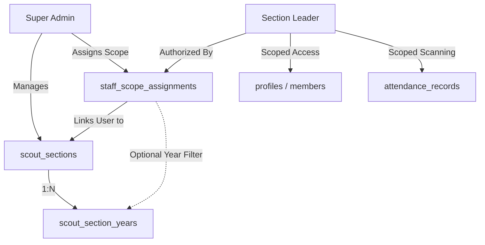

# SCOUT HUB — ROLE REARCHITECTURE & PERMISSIONS MATRIX

**Document Version:** 1.0.0  
**Status:** IMPLEMENTED & LOCALLY VERIFIED  
**Classification:** Architecture & Security Blueprint  

---

## 1. Executive Summary

Scout Hub has undergone a complete architectural re-engineering of its user role model, scope hierarchy, and data access boundary. The previous rigid monolithic role assumption and hardcoded three-stage model (`stage_1`, `stage_2`, `stage_3`) have been replaced by a **Dynamic Scope-Bound Multi-Role Architecture**.

In this new model:
- Roles are strictly partitioned between platform administration (`SUPER_ADMIN`), scoped staff leadership (`SECTION_LEADER`, `ASSISTANT_LEADER`), and ordinary scouts (`MEMBER`).
- Scout organizational stages are fully dynamic, database-backed entities (`scout_sections` and `scout_section_years`), configured directly by the Super Admin.
- Data access for staff is bounded strictly to explicitly granted scopes in `staff_scope_assignments`.
- Unauthorized route escalation and horizontal data leakage are blocked by a 4-layer defense: Proxy Edge Guard, Server Component Layout Guard, Server Action Scope Check, and PostgreSQL Row-Level Security (RLS).

---

## 2. Server-Enforced Roles

| Role Name | Database Key | Scope Model | Primary Access Route | Description |
|---|---|---|---|---|
| **Super Admin** | `super_admin` | Global Platform | `/super-admin` | Platform owner & developer. Full access to sections, years, all members, all leader accounts, scope grants, global attendance, teams, and audit trails. |
| **Section Leader** | `section_leader` | Scoped (Section + Optional Year) | `/leader` | Staff leader assigned to explicit scout sections and/or levels. Can only see/manage assigned members, take Friday attendance for assigned scouts, and publish assigned teams. |
| **Assistant Leader** | `assistant_leader` | Scoped (Section + Optional Year) | `/leader` | Auxiliary staff member. Scanning attendance, read-only member roster, team administration if explicitly permitted. |
| **Member** | `member` | Self-Only (`auth.uid() = id`) | `/dashboard` | Scout member. Can only view own scout card, personal profile, own published patrol, own attendance history, and submit weekly RSVPs. Strictly forbidden from admin routes or peer member PII. |

---

## 3. Dynamic Scout Organization Structure

The previous hardcoded stages have been decoupled from application logic:



### 3.1 `scout_sections`
- `id` (UUID, Primary Key)
- `name` (TEXT, Arabic label, e.g. "الأشبال", "المرشدات", "الجوالة")
- `code` (TEXT, unique slug, e.g. `cubs`, `guides`, `rovers`)
- `description` (TEXT)
- `icon` (TEXT, Lucide icon token)
- `color_theme` (TEXT, e.g. `#1B4332`, `#C05621`)
- `display_order` (INT)
- `is_active` (BOOLEAN)
- `is_archived` (BOOLEAN)

### 3.2 `scout_section_years`
- `id` (UUID, Primary Key)
- `section_id` (UUID -> `scout_sections.id`)
- `name` (TEXT, e.g. "السنة الأولى", "السنة الثانية", "السنة الثالثة")
- `code` (TEXT, e.g. `year_1`, `year_2`)
- `display_order` (INT)
- `is_active` (BOOLEAN)

### 3.3 `staff_scope_assignments`
- `id` (UUID, Primary Key)
- `user_id` (UUID -> `auth.users.id`)
- `section_id` (UUID -> `scout_sections.id`)
- `year_id` (UUID -> `scout_section_years.id`, NULLABLE = grants all years in section)
- `permissions` (TEXT[], e.g. `ARRAY['attendance', 'members_read', 'teams_manage']`)
- `assigned_by` (UUID -> `auth.users.id`)
- `is_active` (BOOLEAN)

---

## 4. Permissions Matrix

| Capability / Resource | `SUPER_ADMIN` | `SECTION_LEADER` | `ASSISTANT_LEADER` | `MEMBER` |
|---|:---:|:---:|:---:|:---:|
| **Platform Overview & KPIs** | All | Scoped Only | Scoped Only | ❌ Forbidden |
| **Manage Scout Sections & Years** | Full CRUD | ❌ Forbidden | ❌ Forbidden | ❌ Forbidden |
| **Manage Staff Accounts & Scopes** | Full CRUD | ❌ Forbidden | ❌ Forbidden | ❌ Forbidden |
| **Read Member Profiles** | All Members | Assigned Scopes Only | Assigned Scopes Only | Own Profile Only |
| **Edit Member Sensitive Data** | Allowed | Assigned Scopes Only | ❌ Forbidden | ❌ (Own phone/name only) |
| **Friday Attendance Scanning** | All Scopes | Assigned Scopes Only | Assigned Scopes Only | ❌ Forbidden |
| **Manual Attendance Override** | Allowed (Audited) | Assigned Scopes (Audited) | ❌ Forbidden | ❌ Forbidden |
| **Team Generation & Publishing** | All Scopes | Assigned Scopes Only | ❌ Forbidden | ❌ Forbidden |
| **View Published Teams** | All | Assigned Scopes | Assigned Scopes | Own Team Only |
| **View Audit Trail Logs** | Read-Only | ❌ Forbidden | ❌ Forbidden | ❌ Forbidden |
| **Export Member/Attendance CSV** | Full Export | Scoped Export Only | ❌ Forbidden | ❌ Forbidden |

---

## 5. Scope Resolution Logic

At request time, whenever a Section Leader or Assistant Leader attempts to perform an operation or query data, the system verifies:

1. **Database Level (`public.has_scope_access(user_id, target_section_id, target_year_id)`):**
   ```sql
   SELECT EXISTS (
     SELECT 1 FROM public.staff_scope_assignments ssa
     WHERE ssa.user_id = check_user_id
       AND ssa.is_active = TRUE
       AND ssa.section_id = target_section_id
       AND (ssa.year_id IS NULL OR ssa.year_id = target_year_id)
   );
   ```

2. **Server Action Level (`src/app/actions/scout-actions.ts`):**
   The caller's authenticated session is fetched via `getCurrentSession()`. If not `super_admin`, their active scope IDs are retrieved from the database. Any query with a requested `section_id` or `year_id` outside the leader's authorized list is rejected immediately with an authorization error.

3. **QR Attendance Engine Level (`verify_qr_credential` & `record_attendance`):**
   When a leader scans a QR badge, the stored credential identifies the member. The function checks whether `public.has_scope_access(scanner_uid, member.section_id, member.year_id)` returns `TRUE`. If false:
   - Verification returns `{"status": "unauthorized_scope"}`.
   - Recording raises SQL error `UNAUTHORIZED_SCOPE: Leader cannot take attendance for members outside their assigned section/year`.
   - No member PII (name, phone, membership details) is leaked to the scanning device.

---

## 6. Route Boundaries & Post-Login Flow

```mermaid
flowchart TD
    Login[User logs in via /login] --> GetSession[Session Created with Supabase SSR Cookies]
    GetSession --> CheckRole{Primary Role?}
    
    CheckRole -->|super_admin| RouteSA[/super-admin]
    CheckRole -->|section_leader / assistant_leader| RouteLeader[/leader]
    CheckRole -->|member| RouteMember[/dashboard]
    
    RouteSA --> SA_Layout[SuperAdminLayout: Server Guard]
    RouteLeader --> L_Layout[LeaderLayout: Server Guard]
    RouteMember --> M_Layout[MemberLayout: Server Guard]
```

- If an ordinary member attempts to browse to `/super-admin`, `/leader`, or `/admin`:
  - `src/proxy.ts` (Next.js 16 Edge Proxy) intercepts the request and redirects to `/dashboard`.
  - If proxy is bypassed, layout guards redirect to `/dashboard`.
  - If an API or action is called directly, server actions reject the request.
  - If direct DB queries are attempted, PostgreSQL RLS returns an empty set or raises permission denied.
